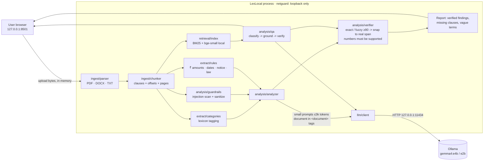

# Architecture

LexLocal is a single local Python process (Streamlit UI and pipeline) that talks to one other local
process, Ollama, over `127.0.0.1:11434`. Nothing else is contacted at runtime.

## Pipeline

| Stage | Module | LLM? | Notes |
|---|---|---|---|
| Parse | `ingest/parser.py` | no | PyMuPDF / python-docx / text decoding; detects encrypted, empty, corrupt, scanned, oversized and non-contract input; NFKC + zero-width cleanup |
| Segment | `ingest/chunker.py` | no | Splits on clause numbering (`1.`, `2.3`, `Clause 5`, `ARTICLE IV`, ALL-CAPS headings); window fallback; exact offsets and page numbers |
| Rules | `extract/rules.py` | no | Parties, roles, dates, ₹/Rs/INR amounts, durations, notice periods, %, governing law. Every fact is an exact span |
| Tag | `extract/categories.py` | no | Lexicon scores route clauses to 9 categories and detect the document type |
| Guardrails | `analysis/guardrails.py` | no | Injection pre-scan; flagged passages are removed from what the model sees and shown to the user |
| Summary | `analysis/analyzer.py` | Gemma | One call over the opening clauses plus the top payment, term and termination clauses |
| Findings | `analysis/analyzer.py` | Gemma | One call per category (payments, penalties, deadlines, notice, termination, obligations, rights, restrictions, liability) with ≤3 clauses each |
| Verify | `analysis/verifier.py` | no | Quote must match the document (normalized exact, else rapidfuzz `partial_ratio` ≥ 90 with ≥85% coverage). It is then snapped to the verbatim span. Sentences with numbers not in the quote or rule facts are dropped, and verdict sentences are scrubbed |
| Checklists | `analysis/analyzer.py` | no | Missing expected clauses (`knowledge/checklists.json` + synonyms) and vague terms (`vague_terms.json`) |
| Q&A | `analysis/qa.py` | Gemma | Rules-first classifier (LLM fallback). Hybrid retrieval -> grounded answer -> verify quotes -> topic-overlap check -> silent / answer / escalate |
| Adversarial | `ingest/adversarial.py` | no | Hidden PDF text (white or background colour, tiny, invisible, transparent, off-page) is flagged **and removed**. Zero-width and bidi controls are stripped, and look-alike Cyrillic/Greek letters in Latin words are normalised |
| OCR | `ingest/ocr.py` | no | Tesseract 5 (eng+hin) for image-only PDF pages. Per-page confidence feeds finding confidence. Temp files and cache live in the session vault |
| Key terms | `extract/structured.py` | no | Rule facts filed into parties, term, lock-in, rent/salary, deposit, notice, penalties, dates and governing law, each with its exact sentence |
| Consistency | `analysis/consistency.py` | rules + Gemma | Conflicts: figures vs words, the same term with two values, term vs dates, lock-in at least as long as the term, two notice periods for one party, plus up to 2 Gemma pair checks with verified quotes. Unusual: one-sided phrases, asymmetric notice, embedding distance to `standard_clauses.json` |
| Self-consistency | `analysis/analyzer.py` | Gemma | Thorough mode resamples up to 2 high-severity categories at T=0.7. Agreement is a confidence signal |
| Confidence | `analysis/confidence.py` | no | Weighted quote match, rule agreement, category fit, self-consistency and OCR confidence; calibration in EVALUATION.md |
| Jurisdiction | `analysis/jurisdiction.py` | no | State from governing law, courts or place of signing. General, number-free notes for the state-dependent topics the document mentions |
| Glossary | `analysis/glossary.py` | mostly no | 45 team-written definitions. Gemma only for recognised terms missing from the file (labelled) |
| Compare | `analysis/compare.py` | Gemma (max 4) | Clause alignment (embeddings + text ratio), word diff, material-change tags, explanations with verified quotes from both versions |
| Export | `report/export.py` | no | Markdown and PDF (PyMuPDF Story) built in memory |
| Vault | `privacy/vault.py` | no | Per-session Fernet-encrypted temp store (in-memory key), wiped on delete, panic, session end and exit |

## Data model (`lexlocal/models.py`)

`Document{pages[], text}` -> `Chunk{id, heading, text, start, end, page, categories}` ->
`Finding{category, title, plain_explanation, quote, chunk_id, page, kind: explicit|interpretation|concern,
severity, confidence, verified, needs_lawyer, ambiguity_note}` -> `Report`.

## Trust boundaries

1. **Document text is untrusted.** It sits inside `<document>` delimiters, the system prompt declares it as
   data, delimiter break-out strings are neutralized, and instruction-like sentences are removed before the model sees the text.
2. **Model output is untrusted.** It is schema-constrained JSON (Ollama `format`) and validated with Pydantic, with
   one retry. Every quote must pass verification, every number must be grounded, and verdict language is removed.
3. **The network is untrusted.** `privacy/netguard.py` patches `socket.connect`, `connect_ex` and `getaddrinfo` so only
   loopback is reachable. HF/transformers run offline, and Streamlit telemetry is off.

## Performance design

- Small prompts: ≤3 clauses (≈3,500 characters) per call, `num_ctx` 4096, `num_predict` ≤700.
- Calls are sequential, so a 4 GB GPU / CPU Ollama is never overloaded. `keep_alive` keeps the model warm.
- Embeddings use bge-small (33M params) on CPU and take well under a second for a typical agreement.
